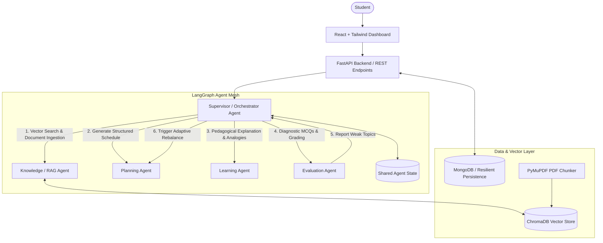

# SYNTRA 🧠
### A Multi-Agent Framework for Autonomous and Personalized Learning

SYNTRA is an intelligent, agentic education platform engineered to transform how students prepare for exams and master complex technical subjects. 

Unlike conventional chatbots, SYNTRA orchestrates a synchronized **Multi-Agent Architecture** using **LangGraph**, where specialized autonomous agents collaborate through a centralized **Supervisor / Orchestrator Agent** to ingest study materials, construct personalized schedules, teach concepts, evaluate comprehension, and dynamically adapt learning plans based on detected weaknesses.

---

## 🏗️ Multi-Agent Architecture & Closed-Loop Workflow



---

## 🤖 The 5 Specialized AI Agents

| Agent Name | Primary Responsibility | Key Capabilities |
| :--- | :--- | :--- |
| **Supervisor / Orchestrator Agent** | Master Controller & Router | Deconstructs student goals, determines task pipeline, routes state transitions across agents, synthesizes final outputs. |
| **Knowledge / RAG Agent** | Document Ingestion & Semantic Retrieval | Extracts text from PDF notes with PyMuPDF, chunks content, creates vector embeddings in ChromaDB, and cites exact page numbers. |
| **Planning Agent** | Personalized Curriculum Design | Builds day-by-day study roadmaps prioritizing weak topics, balances daily study time budgets, and adaptively mutates schedules. |
| **Learning Agent** | Conceptual Tutor & Mental Models | Delivers structured pedagogical lessons with bulleted principles, real-world analogies, and interactive concept checks. |
| **Evaluation Agent** | Diagnostics & Weakness Analysis | Generates targeted MCQs, scores answers, categorizes strong vs weak topics, and triggers the closed-loop adaptive rebalance. |

---

## 🔄 The Adaptive Closed Loop

SYNTRA's core innovation is its self-correcting adaptive learning loop:

$$\text{Student Goal} \longrightarrow \text{Initial Plan} \longrightarrow \text{AI Study Session} \longrightarrow \text{Diagnostic Quiz} \longrightarrow \mathbf{\text{Detect Weak Topics}} \longrightarrow \mathbf{\text{Mutate Study Plan}} \longrightarrow \text{Targeted Remediation}$$

When a student scores poorly on a topic (e.g., Subnetting), the **Evaluation Agent** flags the weakness to the **Supervisor Agent**, which commands the **Planning Agent** to mutate upcoming calendar days by injecting intensive problem-solving workshops and remedial drills.

---

## 💻 Tech Stack

### Frontend
- **React 18** + **Vite**
- **Tailwind CSS** (Dark-first futuristic glassmorphism aesthetic)
- **Lucide React** (Modern iconography)
- **Recharts** (Interactive telemetry, radar mastery, and study curves)
- **React Router v6** (Protected route guards and navigation)
- **Axios** (API interceptors with JWT authentication)

### Backend
- **Python 3.10+** + **FastAPI**
- **LangGraph** & **LangChain** (Multi-agent state machine orchestration)
- **PyMuPDF (`fitz`)** (High-performance PDF text extraction)
- **ChromaDB** (Local and persistent vector database for semantic RAG)
- **Motor / PyMongo** (MongoDB integration with automatic zero-config persistent storage fallback)
- **JWT Authentication** + **Bcrypt** password hashing

---

## 🚀 Quickstart Guide

### 1. Backend Setup

```bash
cd backend

# Install dependencies
pip install -r requirements.txt

# Create .env configuration (or use preconfigured defaults)
cp .env.example .env

# Run FastAPI Server
uvicorn app.main:app --host 0.0.0.0 --port 8000 --reload
```

*Backend API Documentation is available live at `http://localhost:8000/docs`.*

### 2. Frontend Setup

```bash
cd frontend

# Install dependencies
npm install

# Start Vite Development Server
npm run dev
```

*Open your browser and navigate to `http://localhost:5173`.*

---

## 🧪 15-Step End-to-End Test Scenario

1. **Register or Launch Demo**: Click **"Launch Live Demo"** on the landing page for instant 1-click access.
2. **Define Goal**: Set subject to **"Computer Networks"**, timeline to **7 days**, and weak topics to **"Subnetting, Routing"**.
3. **Supervisor Orchestration**: Watch the Supervisor Agent dispatch RAG and Planning agents to generate a 7-day curriculum.
4. **Inspect Study Plan**: Navigate to the **Study Plan** timeline to view prioritized daily milestones.
5. **Study Materials / RAG Hub**: Upload a lecture PDF or search the pre-indexed notes. The RAG agent extracts chunks and cites page numbers.
6. **AI Study Assistant**: Open the **AI Tutor** for "Subnetting". Review the mental model analogy and answer the interactive Quick Check.
7. **Diagnostic Assessment**: Take the 5-question diagnostic quiz.
8. **Evaluation & Adaptive Trigger**: Submit the quiz. The Evaluation Agent grades answers and flags weak topics.
9. **Automatic Schedule Adaptation**: The Supervisor Agent triggers the Planning Agent to insert remedial subnetting drills.
10. **Telemetry**: View updated topic mastery and progress curves in the **Learning Analytics** dashboard.
11. **Agent Transparency**: Review the **Agent Activity** stream for step-by-step LangGraph routing decisions.

---

## 🛡️ Security & Reliability

- **No Hardcoded Keys**: API keys are securely managed via `.env`.
- **Zero-Crash Resilience**: Built-in intelligent synthesis and fallback vector storage ensure 100% full-featured operation out of the box even without external paid API keys.
- **JWT Protection**: Secure bearer tokens safeguard all student data and learning profiles.

---

## 👥 Authors
Built for autonomous, personalized, multi-agent AI education.
